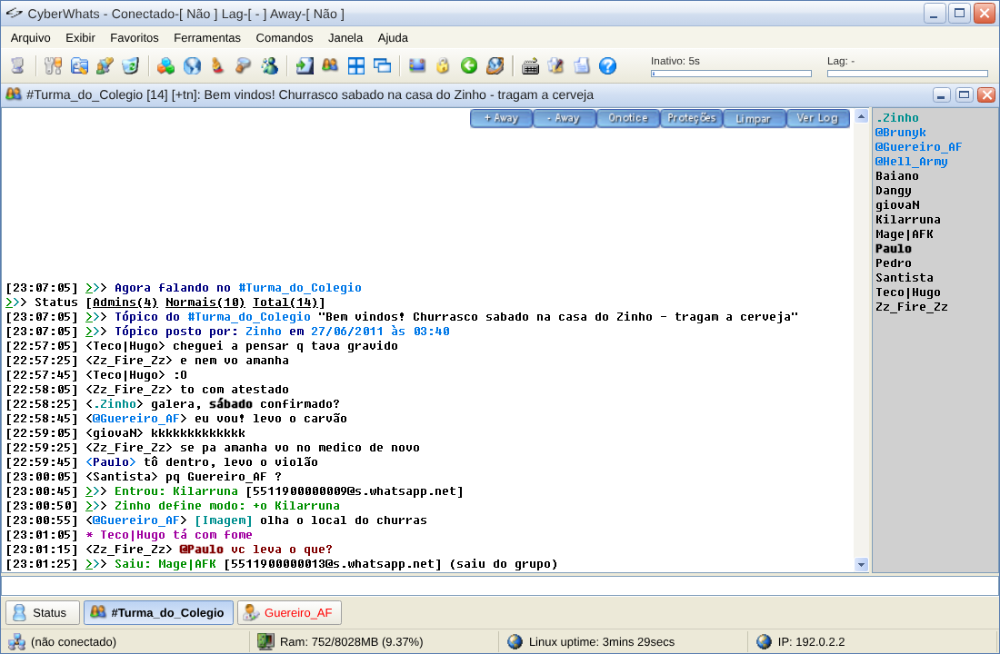
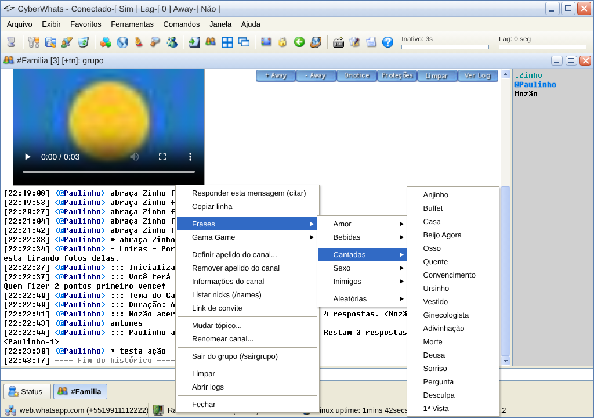

# CyberWhats 3.2

Cliente de WhatsApp para Windows com a cara e o jeito do **CyberScript 3.2** — o script de IRC
que dominava o #brasil nos anos 2000. Grupos viram `#canais`, conversas viram pvts, e tudo
funciona por comandos de barra.



## Download

Baixe a última versão na página de **[Releases](../../releases)**:

| Arquivo | Para quê |
|---|---|
| `CyberWhats-3.2.x.y-portable.exe` | roda direto, sem instalar |
| `CyberWhats-3.2.x.y-setup.exe` | instalador (atalho no menu Iniciar / área de trabalho) |
| `CyberWhats-3.2.x.y-src.zip` | código-fonte daquela versão |

## Como usar

1. Abra o CyberWhats e digite `/server` (ou Ctrl+F12).
2. No celular: WhatsApp > **Dispositivos conectados** > **Conectar dispositivo** e escaneie o QR code.
   Prefere código numérico? Use `/server 55DDDNUMERO`.
3. `/list` mostra seus grupos, `/join #grupo` abre um, `/query nome` abre um pvt, `/contatos` lista seus contatos.
4. `/ajuda` mostra todos os comandos.

Seus dados ficam em `%APPDATA%\CyberWhats` (sessão, logs, configurações, scripts).
Arquivos recebidos vão para `Documentos\CyberWhats\Recebidos`.

## O que tem

- **Visual do CyberScript 3.2**: janelas MDI, switchbar, toolbar, barra de status (RAM, uptime, IP),
  theme "Padrão" (`>>>`), fonte Fixedsys, ícones, botões e sons originais, MOTD estilo BRASnet.
- **Canais e pvts**: nicklist com `@` para admins e `.` para o dono, tópico, modos, entrou/saiu/kick,
  auto-join, notify, ignore, away com janela @Away.
- **Mídia no chat**: figurinhas, fotos, vídeos e áudios aparecem na própria janela.
- **Do jeito antigo**: selecionar texto já copia (com cores invertidas), duplo-clique no nick abre pvt,
  duplo-clique no pvt dá whois, Tab completa nicks, Alt+1..9 troca de janela, clicar de novo no botão
  da janela ativa volta para a anterior.
- **Apelidos locais** para você, contatos e canais (`/meunick`, `/apelido`) — não mudam nada no WhatsApp.
- **Temas**: Padrão, Clássico e Dark.
- **CyberWhats Script**: scripts editáveis com aliases, eventos e menus — já vem com as
  **Frases** do CyberScript e o **Gama Game**.



## Comandos principais

| Comando | O que faz |
|---|---|
| `/server [número]` · `/disconnect` · `/logout` | conecta · desconecta · encerra a sessão |
| `/list [filtro]` · `/contatos [filtro]` · `/recentes [N\|on\|off]` | lista grupos · lista contatos · contatos recentes (abre sozinho ao conectar) |
| `/join #grupo` · `/part` · `/sairgrupo` | abre o grupo · fecha a janela · sai do grupo |
| `/query <nick\|número>` · `/msg <nick> <texto>` · `/r <texto>` | pvt · mensagem · responde ao último pvt |
| `/me <ação>` | ação (`* Nick ação`) |
| `/whois [nick]` · `/names` | informações do contato · participantes |
| `/topic [texto]` · `/assunto <nome>` · `/convite` | descrição · nome · link do grupo |
| `/op` `/deop` `/kick` `/invite` | administração do grupo |
| `/nick <nome>` · `/recado <texto>` | seu nome e recado no WhatsApp |
| `/meunick` · `/apelido <alvo> <apelido>` | apelidos locais |
| `/away [msg]` · `/back` | away |
| `/notify` · `/ignore` · `/autojoin on\|off\|agora` | listas |
| `/enviar` | envia arquivo (ou arraste para a janela) |
| `/motd` · `/lusers` · `/dicas` · `/interface <px>` · `/fonte <px>` | diversos |
| `/frase [categoria]` · `/kickfrase <nick>` · `/gama on\|off\|placar` | scripts que vêm com o app |
| `/scripts` (Alt+R) · `/recarregar` · `//comando` | scripts |

Lista completa, em ordem alfabética: `/ajuda`.

## CyberWhats Script (`.cws`)

Cada script é um arquivo `.cws` em `%APPDATA%\CyberWhats\scripts`, editável em
**Ferramentas > Editor de scripts** (Alt+R). Arquivos `.txt`/`.ini` nas subpastas viram dados:
`$read(frases/cumulos.txt)` sorteia uma linha.

```
; cria o comando /oi
alias oi { say Olá $1 $+ ! }

; responde quando alguém falar "bom dia" num canal
on *:TEXT:*bom dia*:#:{ msg # Bom dia, $nick $+ ! }

; menu de botão direito na nicklist
menu nicklist {
  Saudações
  .Dizer oi:oi $1
}
```

- **Blocos**: `alias`, `on` (TEXT, ACTION, INPUT, JOIN, PART, KICK, CONNECT, DISCONNECT, START),
  `menu` (nicklist, channel, query, status, menubar — submenus com pontos).
- **Controle**: `if / elseif / else`, `while`, `goto`, `return`, `halt`, `var`, `set`, `unset`, `inc`, `dec`.
- **Comandos**: `say msg me describe echo timer kick mode topic join query part hadd hinc hdel writeini write`…
- **Identificadores**: `$me $nick $chan $rand $read $readini $calc $len $upper $left $mid $replace $gettok $iif $time $hget`…
- Referência rápida dentro do app: `/ajuda scripts`.

## Compilar

Requer **Node.js 20+**. O motor `bin/cw-engine.exe` já vem compilado; para recompilá-lo, **Go 1.26+**.

```
npm install
npm start                          # modo desenvolvimento
npm run dist                       # dist\CyberWhats-<versão>-portable.exe e -setup.exe
node tools/versao.mjs 3.2.X.Y      # muda a versão em todos os lugares
```

Motor (Go):

```
cd engine-go
go mod tidy
GOOS=windows GOARCH=amd64 go build -trimpath -ldflags "-s -w -H windowsgui" -o ../bin/cw-engine.exe .
```

### Estrutura

| Pasta | Conteúdo |
|---|---|
| `src/main.mjs` | processo principal do Electron (janela, IPC, scripts) |
| `src/engine-go.mjs` | ponte com o motor (processo `cw-engine`, JSON por linha) e histórico local |
| `engine-go/` | código-fonte do motor em Go (whatsmeow + SQLite puro em Go) |
| `bin/` | motor compilado para Windows |
| `src/renderer/` | interface: janelas, comandos, temas, interpretador do CyberWhats Script |
| `src/scripts/` | scripts padrão (`frases.cws`, `gamagame.cws`) e seus dados |
| `src/engine.mjs`, `src/engine/` | motor alternativo (WhatsApp Web), em Ferramentas > Opções > Motor |
| `tools/` | utilitários de build |

## Versões

O CyberWhats sempre usa **3.2.x.y**, em homenagem ao CyberScript 3.2. Histórico em [CHANGELOG.md](CHANGELOG.md).

## Aviso

Projeto **não-oficial**, sem afiliação com o WhatsApp/Meta. Clientes não-oficiais podem violar os
Termos do WhatsApp e há risco de restrição da conta — use por sua conta e risco e evite automações/spam.

Versão para WhatsApp por **Paulo Johnny Alves** (johnny.alves@gmail.com) — [www.cyberwhats.org](https://www.cyberwhats.org).

Baseado no **CyberScript 3.2**: artes, ícones, sons, temas, frases e o estilo visual são criação da equipe original do CyberScript — todos os créditos a eles. Fonte: Fixedsys Excelsior 3.01.
Motor: [whatsmeow](https://github.com/tulir/whatsmeow) (MPL-2.0).
